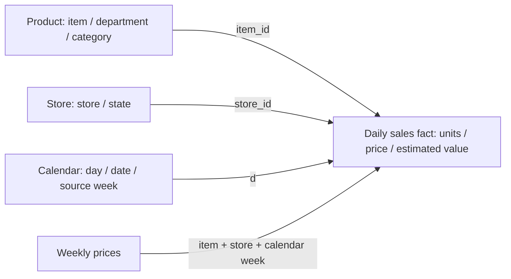

# M5 analytical model acceptance checkpoint

Completed from learner-supplied DBeaver screenshots on 28 October 2026. The assistant transcribed the displayed results; it did not directly open the learner's persistent database. This checkpoint completes the data model stage, not the planned merchandising analysis or forecasts.

| Accepted object | Grain | Rows | Fields |
| --- | --- | ---: | ---: |
| core.m5_product | Product | 3,049 | 3 |
| core.m5_store | Store | 10 | 2 |
| core.m5_calendar | Source day/date | 1,969 | 15 |
| stg.m5_prices | Product/store/source week | 6,841,121 | 4 |
| mart.m5_sales_daily | Product/store/observed date | 59,181,090 | 9 |

The fact covers 30,490 complete 1,941-day series, 2011-01-29–2016-05-22. It preserves 66,927,173 recorded units and 40,241,819 zero-sales observations. The final 28 calendar dates are not additional observed zero sales. Uniqueness and full key coverage are verified; no physical PRIMARY KEY constraints have been declared.

All 12,299,413 missing-price daily rows have zero sales; all positive units have prices. Missing prices remain NULL, with has_price=false. Zero units have estimated value 0.00. Positive units use the matching published weekly price, with exact decimal arithmetic. The accepted full-snapshot estimated sales-value total is **USD 191,577,546.04**. This is a price-based proxy, not verified transaction revenue, net sales, margin, profit, inventory or unconstrained demand.

## Evidence chain

- [Raw layer checkpoint](RAW_LAYER_CHECKPOINT.md) and [staging checkpoint](STAGING_LAYER_CHECKPOINT.md).
- [Dimensions checkpoint](DIMENSIONS_CHECKPOINT.md) and [full dimension joins](DIMENSION_JOINS_VALIDATION.md).
- [Daily price coverage](PRICE_COVERAGE_VALIDATION.md).
- [Daily fact method and tests](SALES_FACT_VALIDATION.md) and [learner fact acceptance](../data/sales_fact_learner_acceptance.json).

The final fact screenshot shows 20 PASS checks and one INFO monetary total. Series keys, all daily units, date/week, price, coverage flag and amount comparisons show no discrepancies. Assistant preflight records remain historical and separate from learner screenshot acceptance. Raw files, databases and screenshots are not published.

## Next scope

The first read-only category report uses 2016-01-26–2016-04-24 inclusive, keeping the forecast holdout out of this decision-oriented analysis. Compare unit share with estimated value share; retain source product counts and price-coverage context. ABC/XYZ classification, forecasts, anomaly work and Power BI remain pending. Follow the [current step](FIRST_STEP_ZH.md).
